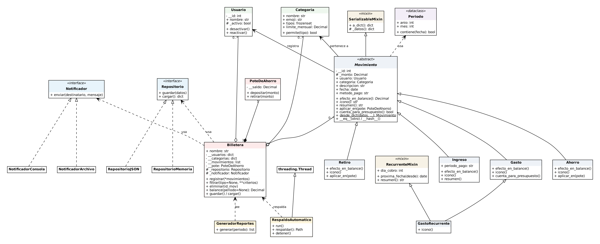

# Gestor de gastos compartidos

Sistema de consola en Python para registrar gastos, ingresos, ahorros y retiros de ahorro entre
varios usuarios. Es el examen práctico integrador de **Programación Orientada a Objetos (LC627)**
de la Universidad CETEC de México y se basa en una app real que construí con Google Apps Script
y Google Sheets.

**Autor:** Edwin Axel Agreda Hernández

## Requisitos

- Python 3.11 o superior (solo biblioteca estándar)
- `pytest`, únicamente para las pruebas

## Instalación

```bash
git clone https://github.com/AxelAgreda/sistema-gestor-gastos.git
cd sistema-gestor-gastos
python -m venv .venv
# Windows:      .venv\Scripts\activate
# Linux / Mac:  source .venv/bin/activate
pip install -r requirements.txt
```

## Uso

```bash
python main.py           # abre el menú; los datos se guardan en datos/gestor.json
python main.py --demo    # demostración guiada de todos los requisitos del examen
python -m pytest -v      # ejecuta las 40 pruebas automatizadas
```

La primera vez que se abre el menú, el sistema carga datos de ejemplo de octubre de 2026.
Mientras el menú está abierto, un hilo guarda un respaldo cada 2 minutos en `datos/respaldos/`.

## Estructura

```
sistema-gestor-gastos/
├── main.py                       punto de entrada (menú o demostración)
├── gestor_gastos/
│   ├── excepciones.py            jerarquía de excepciones propias
│   ├── interfaces.py             Protocol Notificador y Repositorio
│   ├── notificadores.py          NotificadorConsola, NotificadorArchivo, NotificadorMemoria
│   ├── valores.py                dataclass Periodo y conversión de montos con Decimal
│   ├── datos_demo.py             datos de ejemplo
│   ├── demo.py                   demostración guiada
│   ├── modelos/                  Usuario, Categoria y la jerarquía de Movimiento
│   ├── servicios/                Billetera (gestor), PoteDeAhorro, reportes y respaldo con hilos
│   ├── persistencia/             RepositorioJSON y exportación a CSV
│   └── consola/                  menú de texto
├── tests/                        pruebas con pytest
└── docs/diagrama_clases.png      diagrama de clases UML
```

## Diagrama de clases



## Cómo se cumple cada requisito

| Requisito | Dónde está |
|---|---|
| Clase abstracta con 2 métodos abstractos y 1 concreto que los usa | `Movimiento`: `efecto_en_balance()`, `icono()` y `resumen()` |
| 3 o más subclases concretas, una con `super()` | `Gasto`, `Ingreso`, `Ahorro`, `Retiro` y `GastoRecurrente`; `Ingreso` usa `super()` |
| Gestor que agrupa por composición | `Billetera` (movimientos, usuarios, categorías y su `PoteDeAhorro`) |
| Interfaz implementada por clases sin relación de herencia | `Notificador` y `Repositorio` (Protocol), recibidas en el constructor de `Billetera` |
| Excepción raíz y al menos 2 hijas | `GestorGastosError` y 8 subclases en `excepciones.py` |
| Reglas de negocio que fallan | ahorro insuficiente, presupuesto excedido, categoría no permitida, usuario inactivo, monto inválido |
| `try`, `except`, `else` y `finally` | `RepositorioJSON.guardar()`, `main.py` y `demo.py` |
| Archivos | JSON con escritura atómica, CSV, bitácora de avisos y reportes de texto |
| Hilos | `GeneradorReportes` (ThreadPoolExecutor) y `RespaldoAutomatico` (Thread) |
| Herencia múltiple | `Movimiento(SerializableMixin, ABC)` y `GastoRecurrente(RecurrenteMixin, Gasto)` |
| Sobrecarga simulada | `registrar(*movimientos)`, `filtrar(tipo=None, **criterios)` y valores por defecto |
| Identidad e igualdad | `__eq__` y `__hash__` por id; la demostración compara `==` contra `is` |
| Dataclass de valor | `Periodo` (inmutable, con validación en `__post_init__`) |
